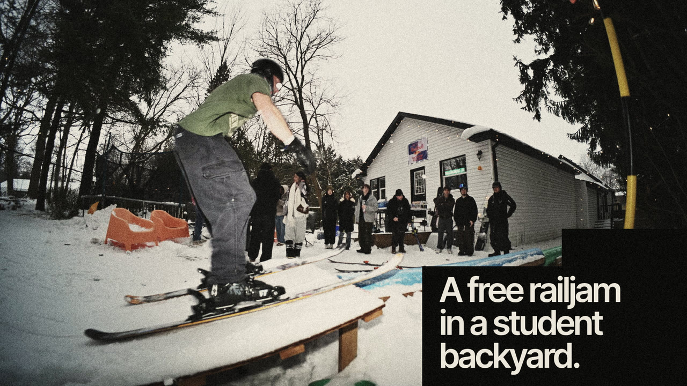
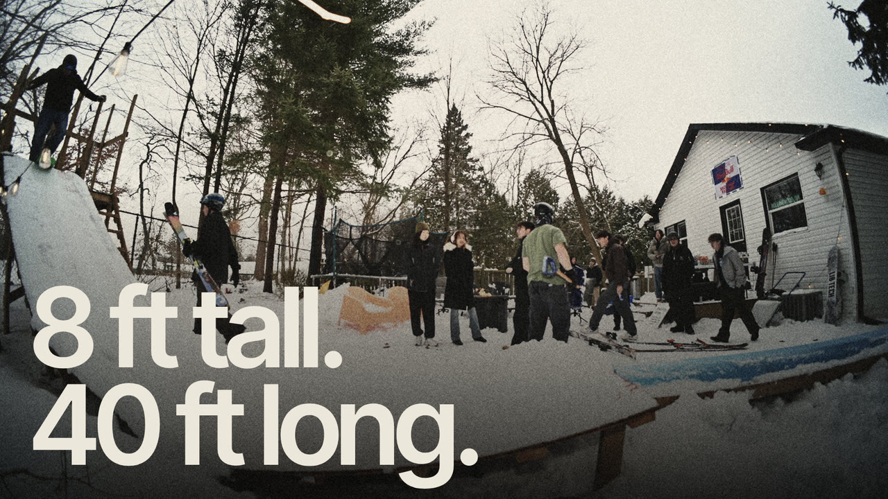
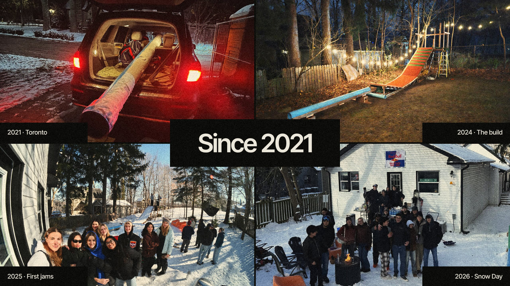
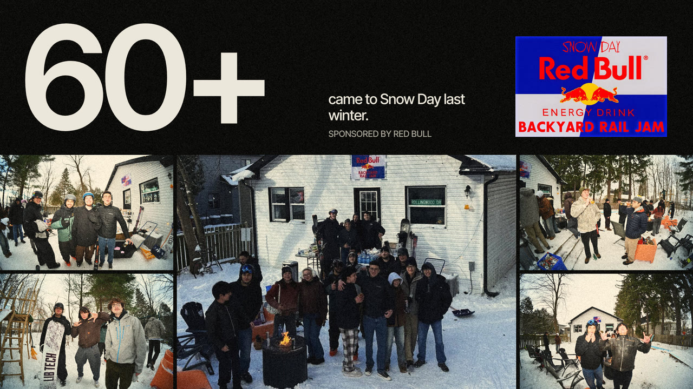
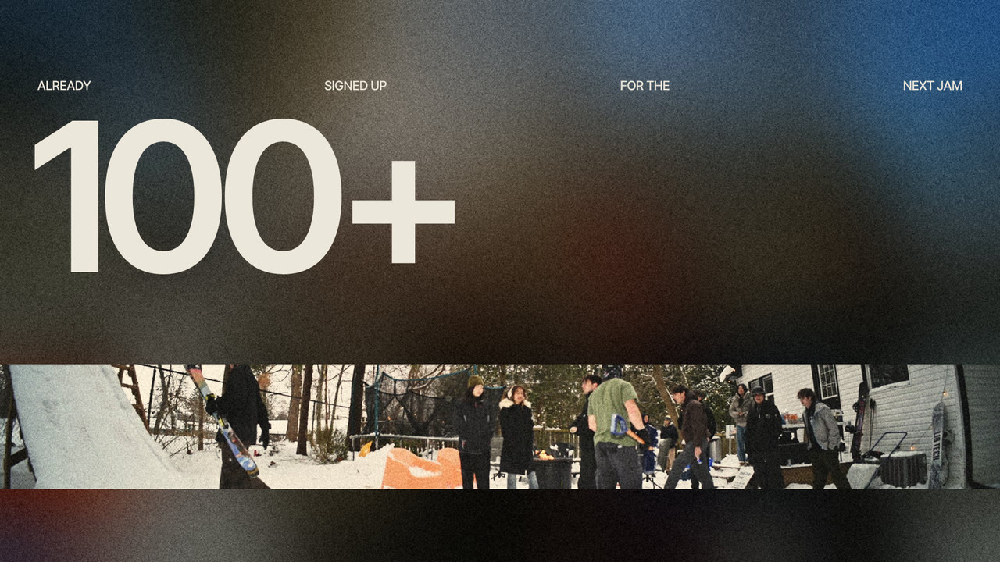
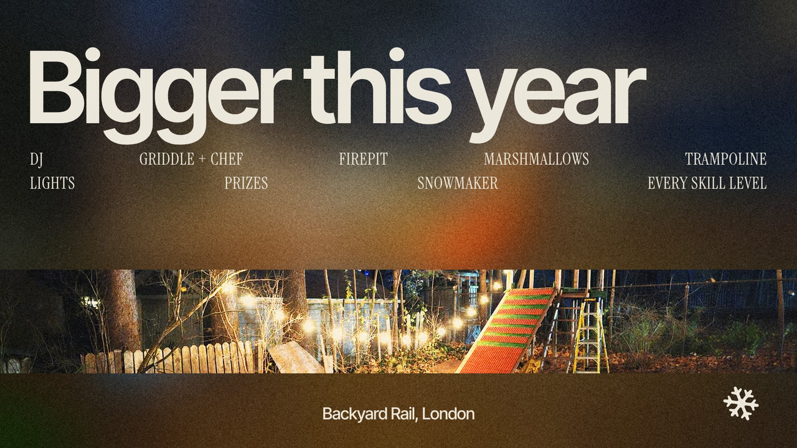
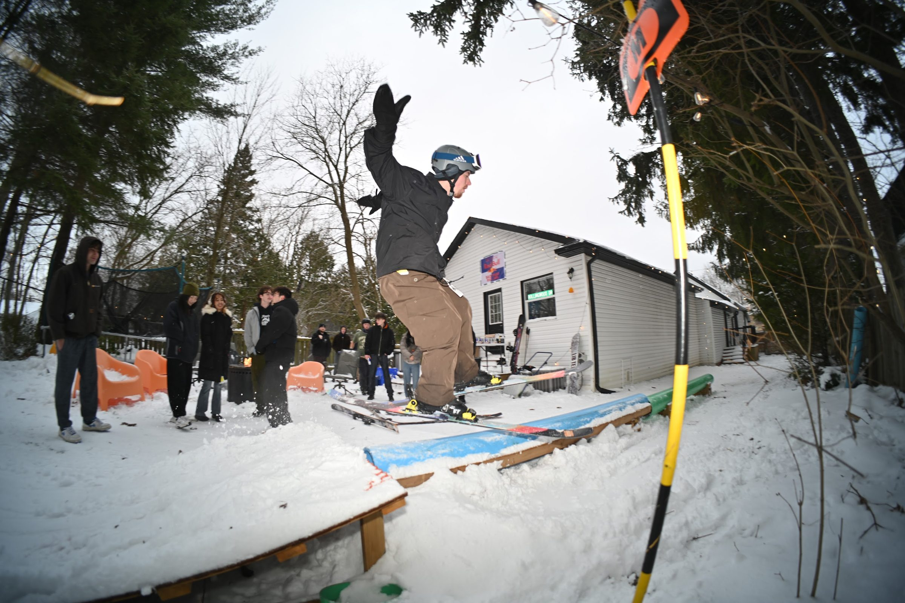
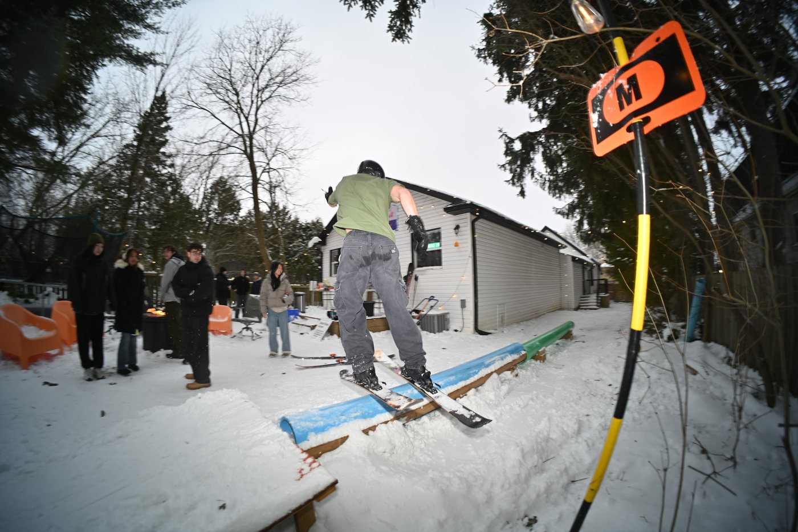
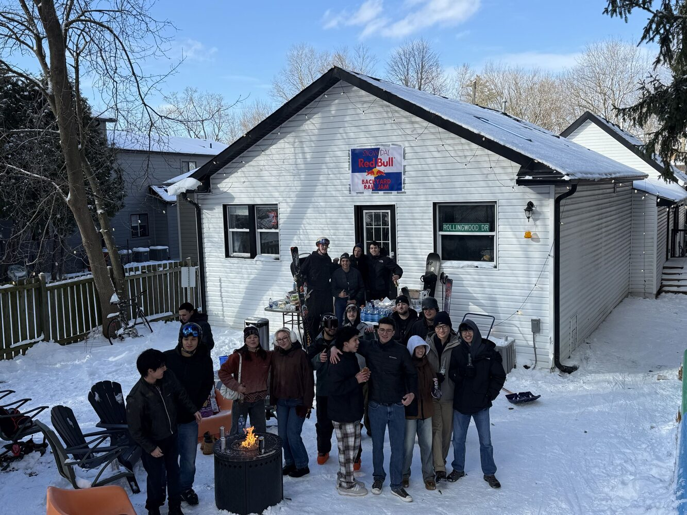

<a href="https://hesh.ca"></a>

# hesh.ca

an 8' tall, 40' long wooden ski ramp and rail in our backyard near Cherryhill Mall, London Ontario.

<p>
 
 
 
</p>

<p>
  
</p>

## Run it

The site needs four test values in a `.dev.vars` file first.

```
TURNSTILE_SECRET=1x0000000000000000000000000000000AA
IP_SALT=local-dev-only
ALLOW_TEST_KEYS=1
ADMIN_PASSWORD=any-local-password
```

```
npx wrangler d1 migrations apply hesh-signups --local
npx wrangler pages dev
```

[hesh.ca](https://hesh.ca) · [@backyardrail](https://instagram.com/backyardrail)
