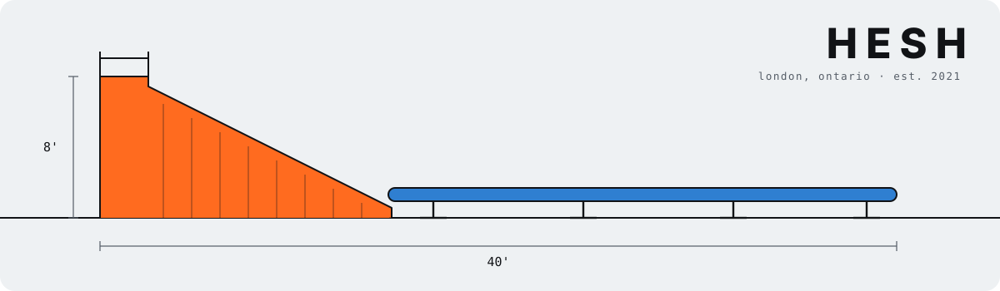

<a href="https://hesh.ca"></a>

# hesh.ca

an 8' tall, 40' long wooden ski ramp and rail in our backyard near Cherryhill Mall, London Ontario.



## Run it

The site needs four test values in a `.dev.vars` file first.

```
TURNSTILE_SECRET=1x0000000000000000000000000000000AA
IP_SALT=local-dev-only
ALLOW_TEST_KEYS=1
ADMIN_PASSWORD=any-local-password
```

```
npx wrangler d1 migrations apply hesh-signups --local
npx wrangler pages dev
```

[hesh.ca](https://hesh.ca) · [@backyardrail](https://instagram.com/backyardrail)
